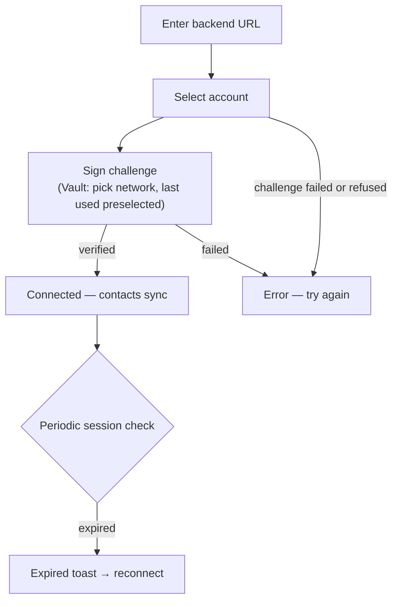

# Address book backend connection & authentication

> Part of the [Feature Map](../../features/README.md) — Last reviewed: 2026-11-20

## Overview

Lets the user connect Nova Spektr to a self-hosted address-book backend and prove account ownership by signing a
challenge. Once authenticated, contacts sync with the backend; the aggregate keeps the session alive and surfaces expiry
or network issues.

## Who can use it / when it applies

- Reached from the address book via the backend configuration modal (add or edit a backend URL).
- Signing requires at least one signable account: a Polkadot browser-extension account or a Polkadot Vault account.

## States / scenarios

| State             | When it appears                                                   | What the user sees                                                                                    |
| ----------------- | ----------------------------------------------------------------- | ----------------------------------------------------------------------------------------------------- |
| URL entry         | Modal opened with no backend or while editing                     | URL input with live reachability probe (checking / reachable / unreachable / wrong backend)           |
| Account selection | URL is valid and the user is not yet connected                    | Account select, preselected with the previously used account when known                               |
| Signing           | Connect pressed                                                   | The message being signed and the signing flow; for Vault accounts also a network selector (see below) |
| Connected         | Session is live and the URL is unchanged                          | Connected account with a disconnect action                                                            |
| Error             | Challenge failed or was refused, or signature verification failed | Error alert with a "try again" action                                                                 |
| Session expired   | Background health check loses the session                         | Toast with a reconnect shortcut                                                                       |

### Account preselection

The account select preselects, in order: the currently authenticated account, the account of the last live session, or
the account used for the last successful sign-in on this device.

- The device-level preference survives disconnects and sign-outs — reconnecting preselects the account the user signed
  in with before, instead of the first account in the list; it only changes when a later sign-in succeeds with a
  different account.
- If the remembered account is no longer signable in the app, the selector falls back to the first account in the list.

### Signing network selection

Vault accounts sign on a specific network, so the signing step shows a network selector (networks listed in the same
order as everywhere in the app: Polkadot group, Kusama group, others, testnets).

- **First-ever pairing**: the selector defaults to the Polkadot relay chain.
- **After a successful sign-in**: the network used is remembered on this device and preselected on every later pairing
  or re-connection — users whose keys live on another network (e.g. Asset Hub) pick it once instead of on every login.
- The remembered preference survives disconnects and sign-outs; it only changes when a later sign-in succeeds on a
  different network.
- If the remembered network is no longer available in the app (removed from the chains config), the selector falls back
  to the Polkadot relay chain.

## Sign-in message

The account signs one text message, and only this one:

```text
<Bytes>ADDRESS_BOOK_AUTH v2
origin: <origin of the backend URL configured in the app>
nonce: <nonce from the backend's challenge></Bytes>
```

- The origin always comes from the backend URL configured in the app, never from the challenge, so the signature is only
  accepted by that backend.
- The backend's challenge has to advertise message version 2. A challenge without a version, or with any other version,
  is refused before anything is offered for signing: no signature request reaches the extension or Polkadot Vault, and
  the modal shows the error state saying that the server does not support the sign-in format the app requires and has to
  be updated. The app cannot sign in to a backend that only issues such challenges.
- A challenge whose nonce is not `0x` followed by 64 lower-case hex characters is refused the same way, with the error
  state.
- The signing step shows the complete message exactly as it is handed to the signer — every character, the `<Bytes>`
  wrapper included, line breaks kept, in a monospace block labelled "Message to sign". Polkadot Vault accounts see it
  above the QR code; extension accounts see it while the extension's own prompt is open.

## Desktop request policy

In the desktop app backend requests go through a main-process proxy that only talks to the configured backend origin
over `https` (plaintext `http` is accepted for `localhost` / `127.0.0.1` / `[::1]` only). The shared backend fetch
helper pins the origin of each request before sending it (so the reachability probe of a draft URL works too); a URL
outside that policy cannot be reached and the modal reports it as unreachable.

## Lifecycle



A successful sign-in stores the session, remembers the account and network for next time, and closes the modal. Clearing
the URL disconnects and logs out; the remembered account and network preferences are kept for the next pairing.

## Related

- Challenge/verify contract with the address-book backend (`domains/backend`).
- Message signing flow (`features/operations/OperationMessageSign`).
